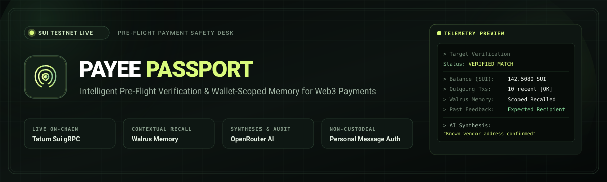
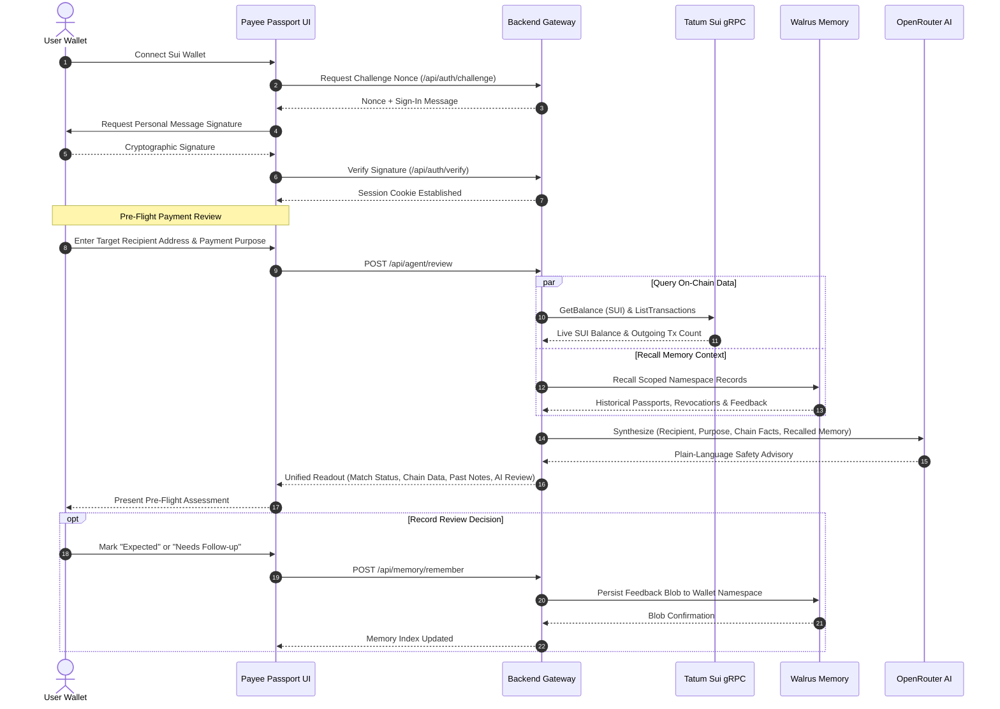

<div align="center">



# Payee Passport

**Intelligent Pre-Flight Verification &amp; Recipient Safety Desk for Sui Payments**

[](https://sui.io/)
[](https://tatum.io/)
[](https://docs.wal.app/walrus-memory)
[](https://openrouter.ai/)
[](https://www.typescriptlang.org/)
[](https://react.dev/)
[-brightgreen?style=flat-square)](https://nodejs.org/api/test.html)

<p align="center">
  <b>Payee Passport</b> is a wallet-gated, non-custodial pre-flight verification system for the Sui blockchain. It cross-references prospective recipient addresses against user-confirmed contacts, live on-chain telemetry retrieved through Tatum gRPC, and tamper-resistant decentralized memory stored in Walrus, synthesizing a plain-language safety evaluation with OpenRouter AI before you sign a transaction.
</p>

[Key Features](#key-features) • [System Architecture](#system-architecture) • [Security & Cryptographic Guarantees](#security--cryptographic-guarantees) • [Getting Started](#getting-started) • [Configuration](#configuration) • [API Reference](#api-reference) • [Testing](#testing--verification)

---

</div>

## Overview

In Web3 payments, transactions are final and irreversible. A single mistyped character, clipboard poisoning payload, or phishing proxy address can result in complete loss of funds. Conventional blockchain explorers provide raw transaction histories, but lack context:
- *Has this address been verified by you previously?*
- *Did you flag this counterparty for follow-up on a previous invoice?*
- *Is this address active on-chain, or is it an uninitialized account?*

**Payee Passport** introduces a dedicated pre-flight verification protocol. Users authenticate via a short-lived cryptographic personal message signature. When an outgoing payment is contemplated, Payee Passport extracts live network telemetry via **Tatum gRPC**, queries wallet-scoped historical context from **Walrus Memory**, compares the address with user-verified passport records, and generates an automated advisory review powered by **OpenRouter**.

> [!IMPORTANT]
> **Non-Custodial Design:** Payee Passport **never** creates, alters, or broadcasts financial transactions, and **never** requests private keys or seed phrases. The application serves strictly as an advisory safety desk.

---

## Key Features

- **Personal Message Wallet Authentication**  
  Zero-gas authentication utilizing Sui's native `isValidPersonalMessageSignature`. Verifies private key ownership with cryptographic nonces and issues short-lived, `HttpOnly` / `SameSite=Strict` session cookies.

- **High-Performance Tatum gRPC Gateway**  
  Direct integration with Tatum's native Sui Testnet gRPC gateway using official Sui RPC v2 Protocol Buffers (`sui.rpc.v2.StateService` and `LedgerService`), querying live SUI token balances and streaming recent outgoing transactions in sub-second latency.

- **Decentralized Contextual Persistence with Walrus Memory**  
  Uses Mysten Labs' hosted `MemWal` SDK to store verified recipient passports, revocation markers, and post-review feedback (`expected` vs. `needs-follow-up`) across deterministic, wallet-isolated namespaces (`passport-${sha256(wallet)}`).

- **Dual-Layer Address Integrity & Conflict Protection**  
  Canonical 64-character hexadecimal normalization (`0x` padded) with collision detection. If an existing contact name points to a differing hex address, the system alerts the user and requires an explicit revocation before updating.

- **Autonomous Multi-Source AI Synthesis**  
  Synthesizes address matching status, real-time balance, recent outgoing activity, and recalled historical interactions into a concise, factual risk assessment via OpenRouter's free router (`openrouter/free`) or customized models.

- **Live Integration Telemetry Strip**  
  Real-time server credential indicators for Tatum, Walrus, and OpenRouter, ensuring transparent connectivity status without exposing sensitive environment variables to client browsers.

---

## System Architecture

```
                                  +-------------------------------------------------+
                                  |             Client Browser (React 19)           |
                                  | - @mysten/dapp-kit-react (Wallet Connection)    |
                                  | - Local Address Cache (Instant Exact Matching)   |
                                  +------------------------+------------------------+
                                                           |
                                      HTTPS / SameSite Cookie Authentication
                                                           |
                                                           v
+---------------------------------------------------------------------------------------------------+
|                                     Payee Passport API (Express)                                  |
|                                                                                                   |
|  [Auth Engine]              [Address Normalizer]          [Session Store]      [Security Guard]  |
|  - Sui Personal Signatures  - 64-byte Hex Formatting     - In-Memory Nonce    - Input Sanitation |
+---------------+-----------------------------+-------------------------------+---------------------+
                |                             |                               |
                v                             v                               v
    +-----------------------+     +-----------------------+       +-----------------------+
    |   Tatum gRPC Gateway  |     |     Walrus Memory     |       |    OpenRouter AI      |
    |  (Sui RPC v2 Protocol)|     |   (@mysten/memwal)    |       |   (Model Synthesizer) |
    +-----------+-----------+     +-----------+-----------+       +-----------+-----------+
                |                             |                               |
                | Balance Query (StateService)| Namespace Memory Indexing     | Factual Advisory
                | Transaction Stream (Ledger) | Tombstone Revocation Trail    | Risk Contextualization
                v                             v                               v
    +-----------------------+     +-----------------------+       +-----------------------+
    |    Sui Testnet State  |     | Decentralized Storage |       |  Explainable Review   |
    +-----------------------+     +-----------------------+       +-----------------------+
```

---

## Verification Lifecycle



---

## Cryptographic & Security Model

### 1. Non-Custodial Personal Message Sign-In
Authentication proves wallet ownership without exposing private keys or requiring on-chain gas:
- Challenge strings bind the current timestamp, cryptographic nonce, domain origin, and network (`Sui Testnet`).
- Signatures are verified server-side with `@mysten/sui/verify` (`isValidPersonalMessageSignature`).
- Validated sessions generate secure session tokens held in `HttpOnly`, `SameSite=Strict` cookies.

### 2. Isolated Walrus Namespaces
To maintain privacy between different wallet users sharing the server's Walrus relayer, memory namespaces are deterministically derived:
```javascript
function ownerNamespace(ownerAddress) {
  const digest = createHash('sha256').update(ownerAddress).digest('hex').slice(0, 24)
  return `passport-${digest}`
}
```
All read (`recall`) and write (`rememberAndWait`) operations are strictly confined to the caller's authenticated namespace.

### 3. Conflict Detection & Immutable Tombstone Revocations
- **Conflict Prevention**: If a user attempts to save a contact name that already exists with a different address, the operation is blocked to prevent accidental overwrites.
- **Tombstone Semantics**: Because the Walrus SDK retains historical records immutably, revocations append an explicit `user-revoked-payee-passport` record timestamped later than the original entry. The review engine evaluates timestamps and automatically ignores revoked entries.

### 4. Zero Secret Exposure
All sensitive credentials (`TATUM_API_KEY`, `OPENROUTER_API_KEY`, `WALRUS_MEMORY_DELEGATE_KEY`) reside exclusively in server-side environment variables. No client-side `VITE_*` secrets exist.

---

## Tech Stack

| Layer | Technologies |
| :--- | :--- |
| **Frontend Framework** | React 19, TypeScript, Vite |
| **Styling & Icons** | Vanilla CSS (Cyber Obsidian / Forest theme), Lucide React |
| **Sui Integration** | `@mysten/dapp-kit-react`, `@mysten/sui` |
| **Backend Runtime** | Node.js (v20+ / v22+), Express 5 |
| **RPC Gateway** | `@grpc/grpc-js`, `@grpc/proto-loader`, Tatum Sui gRPC |
| **Decentralized Memory** | `@mysten-incubation/memwal` (Walrus Memory) |
| **AI Synthesis** | OpenRouter REST API (`openrouter/free` or configurable models) |
| **Testing** | Node.js Native Test Runner (`node --test`), Oxlint |

---

## Getting Started

### Prerequisites

- **Node.js**: `v20.19.0+` or `v22.12.0+`
- **npm**: `v10+`
- A Sui Testnet-compatible wallet (e.g., Sui Wallet, Ethos, Martian)

### Installation

1. **Clone the repository:**
   ```bash
   git clone https://github.com/your-username/payee-passport.git
   cd payee-passport
   ```

2. **Install dependencies:**
   ```bash
   npm install
   ```

3. **Configure environment variables:**
   ```powershell
   # Windows PowerShell
   Copy-Item .env.example .env

   # Linux / macOS
   cp .env.example .env
   ```

4. **Launch development environment:**
   ```bash
   npm run dev
   ```
   * Vite frontend launches at `http://localhost:5173`
   * Express API launches at `http://localhost:3001` (proxied under `/api`)

---

## Configuration

Configure the following variables in your `.env` file:

| Variable | Required | Default / Example | Purpose |
| :--- | :---: | :--- | :--- |
| `PORT` | Optional | `3001` | Local port for Express API |
| `APP_ORIGIN` | Required | `http://localhost:5173` | Allowed CORS origin and sign-in challenge domain binding |
| `TATUM_API_KEY` | Required* | `your_tatum_key` | Server-side API key for Tatum's Sui gRPC gateway |
| `TATUM_RPC_URL` | Optional | `https://sui-testnet-grpc.gateway.tatum.io` | Tatum Sui Testnet gRPC endpoint |
| `OPENROUTER_API_KEY` | Required* | `your_openrouter_key` | Bearer key for OpenRouter AI inference |
| `OPENROUTER_MODEL` | Optional | `openrouter/free` | Chat completion model identifier |
| `WALRUS_MEMORY_ACCOUNT_ID` | Required* | `your_account_id` | Walrus Memory account ID |
| `WALRUS_MEMORY_DELEGATE_KEY` | Required* | `your_delegate_key` | Server delegate key for Walrus Memory authorization |
| `WALRUS_MEMORY_SERVER_URL` | Optional | `https://relayer.memory.walrus.xyz` | Walrus Memory relayer endpoint |

*\*Note: Wallet connection and challenge signing function without external service credentials. Live chain inspection, Walrus memory recall, and AI review endpoints return informative 503 setup alerts until their respective keys are configured.*

---

## API Reference

All protected endpoints require an authenticated wallet session cookie (`passport_session`).

### Authentication Endpoints

#### `POST /api/auth/challenge`
Generates a cryptographic sign-in challenge.
- **Request Body**: `{ "owner": "0x..." }`
- **Response**: `{ "challengeId": "...", "message": "..." }`

#### `POST /api/auth/verify`
Verifies the signature of the personal message and sets the session cookie.
- **Request Body**: `{ "challengeId": "...", "signature": "..." }`
- **Response**: `{ "authenticated": true, "owner": "0x...", "expiresIn": 604800 }`

#### `GET /api/auth/session`
Returns current session authentication status.
- **Response**: `{ "authenticated": true, "owner": "0x..." }` (or `401 Unauthorized`)

#### `POST /api/auth/logout`
Clears server session entry and expires the session cookie.
- **Response**: `{ "loggedOut": true }`

---

### Core Intelligence Endpoints

#### `POST /api/chain/inspect` *(Protected)*
Queries live Sui Testnet state for an address via Tatum gRPC.
- **Request Body**: `{ "address": "0x..." }`
- **Response**:
  ```json
  {
    "mode": "live",
    "network": "Sui Testnet",
    "address": "0x0000...1234",
    "balanceSui": "42.5000",
    "recentTransactionCount": 6,
    "checkedAt": "2026-11-10T14:00:00.000Z",
    "partial": false
  }
  ```

#### `POST /api/agent/review` *(Protected)*
Runs comprehensive pre-flight verification:
1. Performs address normalization and format validation.
2. Reads on-chain balance and outgoing transaction counts via Tatum gRPC.
3. Recalls user passports, revocation markers, and feedback from Walrus Memory.
4. Synthesizes a factual, plain-language assessment via OpenRouter.
- **Request Body**:
  ```json
  {
    "recipient": "0x...",
    "payeeName": "Studio Invoice",
    "purpose": "Monthly design retainer"
  }
  ```
- **Response**: Returns matching status (`match` | `mismatch` | `unverified` | `ambiguous`), chain telemetry, prior user assessment, and synthesized AI advisory.

---

### Memory Management Endpoints

#### `GET /api/memory/status` *(Protected)*
Returns the count of verified memory blobs currently stored in the wallet's Walrus namespace.

#### `POST /api/memory/remember` *(Protected)*
Writes a confirmed passport or review assessment into Walrus Memory with deduplication and waiting confirmation.
- **Request Body**: `{ "text": "{\"type\":\"user-confirmed-payee-passport\", ...}" }`

#### `POST /api/memory/revoke-passport` *(Protected)*
Appends a revocation marker to the Walrus namespace so subsequent pre-flight checks ignore the retired contact.
- **Request Body**: `{ "name": "Studio Invoice", "address": "0x..." }`

#### `POST /api/memory/recall` *(Protected)*
Performs semantic and text query retrieval across the wallet's Walrus Memory namespace.
- **Request Body**: `{ "query": "Studio Invoice" }`

---

## Testing & Verification

The project includes an automated test harness designed to validate all authentication paths, cryptographic challenge lifecycles, address sanitization, and graceful failure handling without leaking mock credentials.

```bash
npm test
```

### Test Suite Coverage

```
✔ health reports the real Testnet and unconfigured services without exposing credentials
✔ protected routes reject requests without a wallet session
✔ one-time challenge authenticates only the wallet that signed it
✔ invalid address validation runs before the missing Tatum credential check
✔ real memory and agent routes fail clearly instead of returning simulated content
✔ logout invalidates the server session
```

All unit and integration tests run against isolated API instances with throwaway test keypairs, verifying deterministic behavior in production configurations.

---

## Available Scripts

| Command | Action |
| :--- | :--- |
| `npm run dev` | Starts both the Express API and Vite frontend concurrently |
| `npm run dev:web` | Starts the Vite frontend only (port 5173) |
| `npm run dev:api` | Starts the Express API backend only (port 3001) |
| `npm run build` | Compiles TypeScript code (`tsc -b`) and generates production bundles (`vite build`) |
| `npm run lint` | Runs `oxlint` for high-speed code quality inspection |
| `npm test` | Executes the backend test suite with Node's native test runner |
| `npm run preview` | Previews the production build locally |

---

## Production Deployment Checklist

When promoting Payee Passport to production environments:
1. **Enforce HTTPS**: Set `Secure` on session cookies (automatically applied when `NODE_ENV=production`).
2. **Configure Strict CORS**: Set `APP_ORIGIN` to your verified production domain (e.g. `https://payeepassport.io`).
3. **Session Store Scaling**: Transition from in-memory session maps to a persistent, distributed store (such as Redis) with automated TTL eviction.
4. **Rate Limiting**: Apply rate limiting to `/api/auth/challenge`, `/api/agent/review`, and `/api/chain/inspect` to safeguard API quotas.
5. **Walrus Production Delegation**: Assign a dedicated, least-privilege Walrus delegate key scoped to application operations.

---

## Security & Operational Disclaimer

- **Signals, Not Legal Identity**: On-chain balance, outgoing transaction counts, and AI-generated text reflect live blockchain observations; they cannot certify real-world legal identity or guarantee physical safety.
- **User Authority**: A saved passport represents a user-confirmed assertion. The user maintains sole discretion and authority over whether to execute or cancel any blockchain transfer.
- **Advisory Scope**: Payee Passport is an advisory pre-flight instrument and never assumes custody or control over digital assets.

---

## License

This project is open-source and distributed under the [MIT License](LICENSE).
